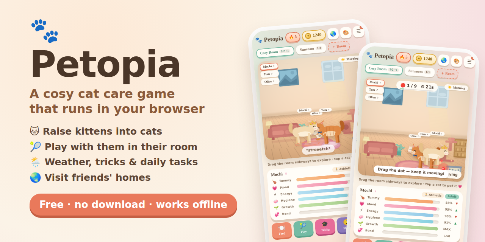
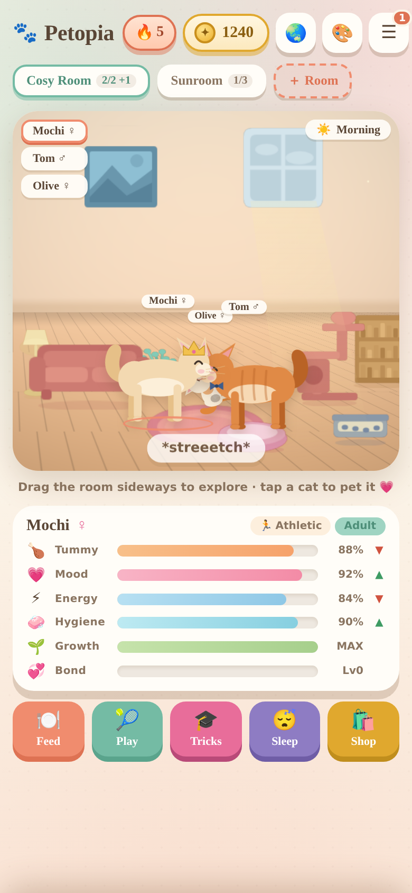
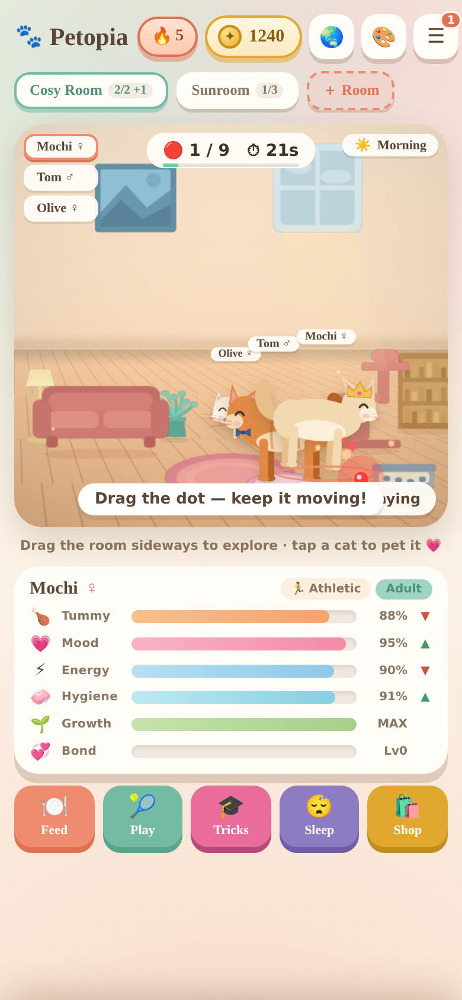
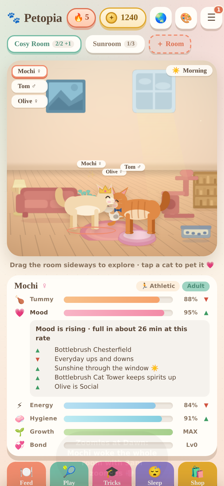
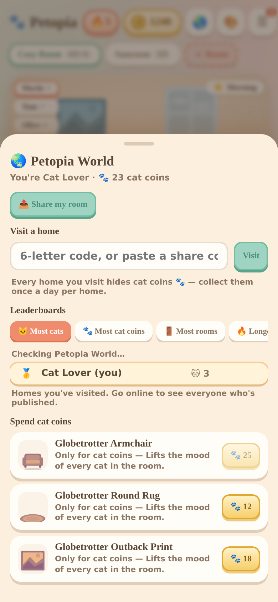

# Petopia 🐾 a cosy cat care game in your browser



**A free virtual pet game about cats.** Raise kittens into cats, keep them fed, clean and happy, decorate their rooms, teach them tricks, play with them, and share your home with friends in Petopia World. A little like Tamagotchi but open source and raise real and fantasy pets.

**▶ [Play in your browser](https://br8t.com/petopia/)** ([or on GitHub Pages](https://catancats.github.io/Petopia/)) · **⬇ [Download](https://github.com/CatanCats/Petopia/archive/refs/heads/main.zip)**

<p align="center">
  
  
  
  
</p>

---

**To download the game**
1. On GitHub, press Code → Download ZIP and unzip it.
2. Open `Petopia.html` or `index.html` for the welcome page.

`petopia/` is the game with the music. You can also just download the petopia.html file.

Your save is saved in the browser. Settings → **Start a brand new home** restarts from the beginning. If that does not work, try pressing **Ctrl+Shift+R** (Cmd+Shift+R on a Mac) so the browser deletes it cached data. 

---

## Your cats

You must deal with each animals four needs, plus growth and bond:

| Bar | Goes down when… | Goes up when… |
|---|---|---|
| 🍗 Tummy | time passes (slower while asleep) | you feed them |
| 💗 Mood | time passes; faster if they're hungry, tired, grubby, the room's messy, or it's dark at night | pats, games, tricks, mood furniture, sunshine |
| ⚡ Energy | they're awake (faster at night or when starving) | they sleep, especially in a bed |
| 🧼 Hygiene | the floor or litter tray is dirty | the room is kept clean |
| 🌱 Growth | — | eating, toys, winning games (not while sick) |
| 💞 Bond | — | pats, tricks, toys, games, and slowly on its own when all four needs are high |

**Tap for more information the bar or small arrow for more information. The panel lists why you got that rating, like for example "Dirty litter tray", for hygiene might reduce its level.

Life stages include kitten → teen → adult. Level up growth to grow your cat, a sick cat can't grow until it's better.

**Neglect:** if needs stay very low a animal gets sick, then weak. With *away mode* on (the default), a badly neglected cat wanders off instead of passing away, and you bring it home by playing the **Homeward Maze** game. Otherwise your animal dies.

### Traits

Every animal has different traits that help make up its personality. Kittens usually inherit one from a parent.

| Trait | What it does |
|---|---|
| 🐾 Easy-going | No quirks. |
| 🪵 Scratchy | Scratches more; wears the sofa down faster without a post. |
| 🙄 Picky | May bring cheap food (kibble, treats) straight back up. |
| 😇 Helpful | Earns coins while you're away. |
| 😼 Naughty | Plays rough and knocks things over. |
| 🙀 Accident-prone | Misses the tray more often. |
| 😪 Sleepy-head | Naps more, and wakes up in a great mood. |
| 🫂 Social | Boosts the mood of everyone in the room. |
| 🫣 Shy | Warms up to pats more slowly. |
| 🍗 Greedy Guts | Empties the auto-feeder, but grows faster. |
| 🏃 Athletic | ×1.4 game payouts, faster in Laser Dash, leaps higher in Feather Chase. |
| 💅 Vain | Stays cleaner, and loves wearing a costume. |

There are 14 breeds to collect, from Cream Puff to Chocolate Mink.

---

## Caring for them

- Feed them with different foods, from cheap kibble to a Royal Feast, plus Kitty Medicine for sickness. If you play the game rockpool fishing you get a free meal to feed you animal.
- Pat by tapping an animal to select it, then tap its head, chin, tummy or paws. Sometimes a animal rolls over: give a **tummy rub* within a few seconds for a big combo.
- Sleep: tired cats nap on their own; the Sleep button sends the selected cat off now. A bed makes naps far more restful.
- Keep your cat clean: tap messes on the floor, and tap a litter tray to scoop it. Every adult cat wants its own tray if you do not give them one they might poop on your floor.

### Furniture

There are 56 kinds of furniture in 21 colourways. Place them in decorate mode (🎨) or from the shop. Drag to move, and many pieces also have a positive effect, for example:

| Effect | Pieces (examples) |
|---|---|
| Lifts mood | sofas, armchairs, rugs, plants, art, record player, fish tank |
| Better naps | cat beds (best), beanbags, cushions |
| Tops energy up | cat hammock |
| Mood drains slower | cat tower |
| Tummy empties slower | water fountain |
| Birdwatching | window perch |
| Cats play with it on their own | cardboard box, play tunnel, toy basket, yarn ball |
| Scratch here, not the sofa | scratching posts and ramps |
| Toilet | litter trays |
| Feeds hungry cats | auto-feeder (tap it to fill) |
| Lights the room at night | lamps |

Each Room hold a set number of residents: Cosy Room 2, Small 3, Medium 5, Large 7, Grand Hall 10, you start off with a room and if you need more space, buy more rooms. Cats wander between rooms, and a visitor shows as "+1" on the room tab. There are 8 **room styles** (wallpaper, floor, light and music together), 22 wallpapers and 16 floors.

---

 ### Tricks

Your animals can do tricks, and rest for a while after they do one. To teach one, build your bond.

| Trick | Bond | Learnt from | Job | Rests |
|---|---|---|---|---|
| 🪑 Sit | 20 | Feather Chase | On best behaviour for 15 min: no sofa scratching, knocking things over or missing the tray | 10 min |
| 🖐️ High Five | 40 | Rockpool Fishing | +15 energy over 10 min, and the next game is easier | 20 min |
| 🔄 Roll Over | 60 | Yarn Maze | Rolls over for a tummy rub, right now | 30 min |
| 🗣️ Speak | 80 | Laser Dash | Tells you which cat in the whole house needs you most, and why | 5 min |
| 💃 Dance | 100 | Purr Rhythm | Lifts every cat in the room for 20 min, and they all become closer friends | 60 min |

---

## Play

Play opens a panel about the selected cat. At the top is what it wants right now and why: a trick it's wants to learn, a game it wants to play before a nap, fishing with you when active, the laser for a Naughty cat. Each game rests after a win, but you can retry a loss straight away.

**In the room, with your real cat:**

| Game | How | Special reward |
|---|---|---|
| 🔴 Laser Dash | Drag the dot across the floor; your cat chases, crouches and pounces. Keep it moving: a pounce only counts after you've moved the dot on. | Tuckered out: on best behaviour for 10 min |
| 🪶 Feather Chase | The feather swings overhead; tap to leap as it swoops past. | Extra bond |

**Outings, on their own screen:**

| Game | How | Special reward |
|---|---|---|
| 🐟 Rockpool Fishing | Stop the marker in the blue | A fish for a free meal (two if it's raining; closed in a storm) |
| 🧶 Yarn Maze | Steer the yarn through the gaps | A big growth boost |
| 🎵 Purr Rhythm | Tap notes as they reach the line | Restores energy, so tired cats can still play |

Toys from the shop can be used from the same panel.

---

## 📋 Daily tasks and streaks

Three tasks each morning, picked from what's actually going on in your home: *Teach Mochi Sit*, *Light up the Cosy Room*, *Find a meal Biscuit keeps down*, *A tray for every cat*. Each has a **Go** button that takes you straight to the fix. Caring for a cat once a day keeps your 🔥 streak going.

## 🌦️ Weather

The weather follows Australian seasons, with summer storms and the odd snowy winter day, and changes every three hours. Watch it through your windows, and tap the time chip for a forecast. Settings can switch it off.

| Weather | Effect |
|---|---|
| ☀️ Sunny | A sunbeam through the window lifts mood |
| ⛅ Cloudy | Nothing special |
| 🌧️ Rain | Sleepy cats; cosy with a lamp on, gloomy without |
| ⛈️ Thunderstorm | Scary, unless there's a bed or tunnel to hide in; lightning makes cats jump |
| ❄️ Snow | Chilly; cats sharing a room snuggle up |

## 💞 Breeding

Two grown, well-fed, well-rested cats with enough bond can have a kitten (Shop → Breed). The pair meet at the bed, sit face to face and stay together for the hour: first getting acquainted, then snuggled up. The kitten arrives between them. Tap either cat to see how it's going.

## 🏆 Achievements, coins and the shop

There are 30 achievements. **Coins** come from care, games and tasks, with a gentle hourly cap. **Cat coins 🐾** only come from visiting other players' homes (see below).

---

## 🌏 Petopia World: share, visit, compete

Open it with the 🌏 button at the top.

### Your name comes first

Before you share anything, you pick a name for other players to see, like *cat lover*. It has to be 2–20 letters, numbers or spaces, and hateful words are blocked. **Don't use your real name. Your name is public.**

### Share a room with a friend

🌏 → **Share my room** → choose a room → **Copy code** (or **Send**). Your friend opens 🌏 → **Visit a home** and pastes it. The code can sit inside a message; the game finds it.

The code *is* the room (compressed), so it works with no server, but it's too long to type. It's a snapshot, so share again after you redecorate.

> **Anyone with your code can see that room:** its furniture, the cats who live there, their names, and your player name.

### Publish to Petopia World (public)

🌏 → **Share my room** → **Publish** gets you a **6-letter code** anyone can type, like `KTZ4QA`, and a place on the public leaderboards. It takes a second and needs no account: the game sends the room to the Petopia World server, which answers with the code, and the game remembers it.

Your home is there for everyone straight away. **Update my published home** shows the room you picked instead and keeps the same code. **Take my home down** (under your code) removes it, and the code stops working.

> **Published homes are public.** Anyone can visit them, and they're listed on the leaderboards.

### Visiting and cat coins

Visiting shows the other player's room with their cats wandering about. You can pet them, but nothing you do changes their home. Your own home waits, paused, until you press **Go home**.

Every home hides **3–7 cat coins 🐾** (more if they have more cats). Tap them to collect. You can collect in each home once a day. Spend cat coins on **Globetrotter** furniture, which can't be bought any other way.

### Leaderboards

Four boards: 🐱 **most cats**, 🐾 **most cat coins** collected, 🚪 **most rooms** and 🔥 **longest streak**. They include everyone who's published, plus you, plus any home you've visited by code. Offline, the game shows the last copy it saw. Numbers are what each player's game reports, so this is for fun, not a contest with prizes.

### How it works (for the curious)

- Published homes live on the **Petopia World server** at `https://br8t.com/petopia/world/`: `index.json` (the leaderboard) and `rooms/<CODE>.json` (one per home). Every copy of the game reads them from there: br8t.com, GitHub Pages or a downloaded file.
- **Publish** sends the share code to `publish`. The server (`world/server/`, a small Rust program) checks it field by field, with the same rules as the game, and answers with the code.
- **Who owns a home:** each game makes a random secret key the first time it publishes and keeps it in its save. Only that key can update or take down the home. The server stores a hash of the key, never the key itself, and nothing secret is in the public files.
- **Limits:** one home per game (publishing again replaces it). The server also allows 3 homes per key, 6 new homes a day and 20 publishes in 10 minutes from one internet address, and 2000 homes in all.
- The game checks everything that arrives from a code or from the server (`cleanHome()` in `Petopia.html`) before using it.

### Looking after Petopia World (server owner)

- **Server:** `petopia-world.service` runs `/srv/apps/petopia/petopia-world` as user `petopia` on `127.0.0.1:8015`, with its data in `/srv/apps/petopia/data/` (`index.json`, `rooms/`, and `owners.json`, which holds the key hashes and is never served). Caddy, inside the `br8t.com` block: `handle_path /petopia/world/* { reverse_proxy 127.0.0.1:8015 }`, and the game files from `/srv/apps/petopia/site` at `/petopia/`.
- **Build:** `cd world/server && cargo build --release` (`cargo test` checks the code reader). `GET /status` gives the number of homes.
- **Removing a home:** stop the service, delete its entry from `data/index.json`, its `data/rooms/<CODE>.json` and its line in `data/owners.json`, then start the service.
- **Blocked words** live in two places that should match: `NAME_BLOCK` in `Petopia.html` and in `world/server/src/main.rs`.
- **Forks:** change `WORLD_API` near the top of the Petopia World section in `Petopia.html` to your own server.

---

## Files

| Path | What it is |
|---|---|
| `index.html` | The welcome page: what Petopia is, screenshots, and a Play button |
| `Petopia.html` | The game: one file, all code and art inside |
| `petopia/petopia.html` | The same game, for the self-contained folder (only its songs path differs) |
| `petopia/Songs/` | Background music |
| `petopia/IDEAS.md` | Design notes on mini-games |
| `world/server/` | The Petopia World server (Rust) and its systemd service file |
| `media/` | Screenshots and the link-preview image (`social-preview.png`) |
| `sitemap.xml`, `robots.txt` | Help search engines find the online version |
| `Old Versions/` | Earlier versions, kept for reference |

**Changing the game:** edit `Petopia.html`, then refresh the folder copy so the two stay identical apart from the songs path:

```sh
sed 's#^const SONGS_DIR="petopia/Songs/";#const SONGS_DIR="Songs/";#' Petopia.html > petopia/petopia.html
```

The code is split into numbered sections (search for `═══`). Stats are driven by `catRates()`, which both the game tick and the stat panel use.

## Getting found

Some of this only the repo owner can do on GitHub:

1. **Description and topics:** on the repo's front page, the ⚙️ next to **About**.
2. **Website:** turn on **Settings → Pages → Deploy from a branch → `main` / root**. The game is then playable at `catancats.github.io/Petopia`, and `index.html` is its front page. Put that link in **About → Website**.
3. **Social preview:** **Settings → General → Social preview**, then upload `media/social-preview.png`. It's the picture shown when the repo link is shared.

Already in the files: link previews (title, description and image) in `index.html` and `Petopia.html`, a page icon, a sitemap and `robots.txt`.

## Licence

The game's code, art and design are under **CC BY-NC-SA 4.0**; see [`LICENSE`](LICENSE). The music was generated with Suno and follows Suno's terms; `LICENSE` has the details.

---

## Ideas for what's next

**Bigger features**
- **More kinds of pets.** The name promises a household of pets. The renderer recolours one drawing into many colours, and pets already grow through life stages, so a bunny or puppy would reuse a lot.
- **Visitors to your home.** Neighbours (NPCs) who drop by, have favourite cats and leave tips, with happier, cleaner cats earning more. That would give every care stat a reason to matter at once.
- **A scrapbook per cat:** photo mode plus automatic moments (first trick, first friend, growing up, their kittens).

**Petopia World**
- **Leave a gift when you visit:** a treat that shows up in the other player's home next time they share. It needs the server side to carry it.
- **Themed weekly contests**, like "best Halloween room", voted by visitors.
- **Guest book:** visitors pick from friendly preset messages (no free text, so it stays safe for kids).
- **Show visits:** "12 people visited your home this week".

**Depth**
- **Real save upgrades instead of wipes:** a proper step-by-step upgrade using the save's version number, so future changes never need a fresh start.
- **Save backup:** export and import your save as a file.
- **Offline progress that uses the same maths** (`catRates`) as live play. Right now furniture doesn't help while you're away.
- **Visible friendships:** friends nap together and groom each other, and rivals squabble.
- **A family tree** for kittens, with markings passed down that you can see.

**Polish**
- **A guided first five minutes** for new players: feed, pet, clean, decorate.
- **Accessibility:** bigger-text and reduced-motion settings; keyboard play for the mini-games.
- **Automated tests:** the browser test scripts used during development could live in the repo and run on every change.
